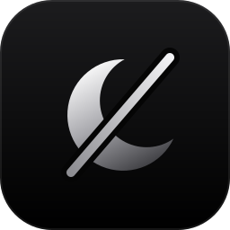

<p align="center">
  
</p>

<h1 align="center">Non-Sleep</h1>

<p align="center">
  <strong>Keep your Mac awake. Give the session an end time.</strong>
</p>

<p align="center">
  
  
  
</p>

A small menu bar app. Type how long, press Enter, and your Mac stays awake until then.
It stops by itself when time is up, when the battery gets low, or when the Mac runs hot.

## Two modes

| | Standard | Lid closed (opt-in) |
|---|---|---|
| Stays awake | Yes | Yes, even with the lid shut |
| Needs sudo | No | Yes, once, through a script you run yourself |
| How | IOKit power assertion | `pmset disablesleep` |
| If Non-Sleep crashes | The kernel drops the assertion | A backstop agent turns it off |

## Install

Needs Xcode (Swift 6) on an Apple Silicon Mac with macOS 14 or later.

```bash
git clone https://github.com/juansuarezdev/non-sleep.git
cd non-sleep
./scripts/build-app.sh
open dist/NonSleep.app
```

The build is ad-hoc signed, so macOS may ask you to allow it the first time.

## Using it

1. Click the moon in the menu bar.
2. Type a duration (`90`, `45m`, `2h`, `1h30m`) or pick a preset, then press Enter.
3. Add time with **+30m** / **+1h**. End early by **holding** "Hold to end" for one second.

While a session runs, the menu bar shows the time left.

### Lid-closed mode

Off until you turn it on:

```bash
./scripts/install-lid-helper.sh
```

It adds a sudoers rule for exactly two commands and a launchd backstop. Read the header of
the script first. To remove everything: `./scripts/uninstall-lid-helper.sh`.

> **Safety.** A Mac that stays awake with the lid shut can overheat in a bag or on a bed.
> Keep it on a hard, ventilated surface. Non-Sleep ends the session at serious heat in lid mode
> and at critical heat always, but that is a safety net, not a guarantee.

## What it will not do

- No network access, no telemetry, no accounts.
- No background daemon unless you install the lid helper.
- The sudoers rule can be used by any program running as you, not only Non-Sleep.

## How it works

See [docs/how-it-works.md](docs/how-it-works.md).

## Develop

```bash
swift test        # unit tests for the logic
swift run NonSleep   # run without bundling
```

## License

MIT
